<!-- ═══════════════════════════════════════════════════════════════════════════ -->
<!--  README ASCII / RED  ·  banners animados gerados por scripts/build_banners.py -->
<!-- ═══════════════════════════════════════════════════════════════════════════ -->

  

  

  

  
  
  
  

  

  

  

